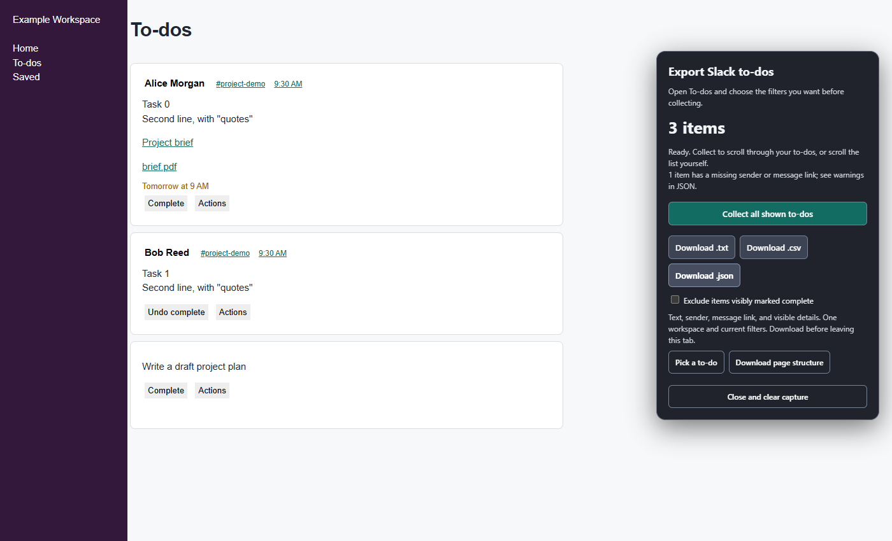

# Slack To-do Exporter

Save your Slack to-dos as **TXT, CSV, or JSON**, with message text, sender names, and links back to the original messages. Handy for reviewing tasks outside Slack or moving them into another tool.

A browser bookmarklet. No installation, Slack app, or API key needed.

## Use it

1. Download this repo as a ZIP and extract it.
2. Open **`setup.html`** in the desktop browser where you use Slack.
3. Press **Ctrl + Shift + B**, then drag **Export Slack to-dos** onto the bookmarks bar.
4. Open **To-dos** in [Slack](https://app.slack.com/) and choose your filters.
5. Click the bookmark, then **Collect all shown to-dos**. Keep the tab open while it scrolls.
6. Check the count against Slack, then download **TXT**, **CSV**, or **JSON**.

For every to-do, include all statuses and reminder options in Slack's filters. For unfinished tasks, choose **In-progress**. Export each workspace or view separately, and leave filters unchanged while collecting.



## What it saves

Message text, sender, message link, channel, timestamps, reminders, completion state, and links when available. JSON includes warnings for missing details. CSV protects message text from being treated as spreadsheet formulas.

**Zero items?** Click **Pick a to-do**, select a task's text, then collect again. See [troubleshooting and limits](docs/usage.md) if needed.

## Privacy and limits

The helper reads the current page and saves files locally. It does not read account tokens or cookies, post to Slack, or upload exports. Scrolling lets Slack load more items normally.

This captures the selected view, not a full account backup. Custom tasks and unavailable messages may lack a sender or link. Files are saved as links. Slack layout changes can affect capture; live compatibility still needs checking in your account. Screenshots and tests use fictional data.

## Development

Stack: plain JavaScript, HTML, Node.js, and Playwright Core. Node.js 22+ is needed only for development.

```powershell
npm install
npx playwright-core install chromium
npm run check
```

`npm run build` rebuilds the setup page. [Development notes](docs/development.md) cover Edge, tests, and the folder layout.

MIT licensed. Independent project, not affiliated with Slack.
